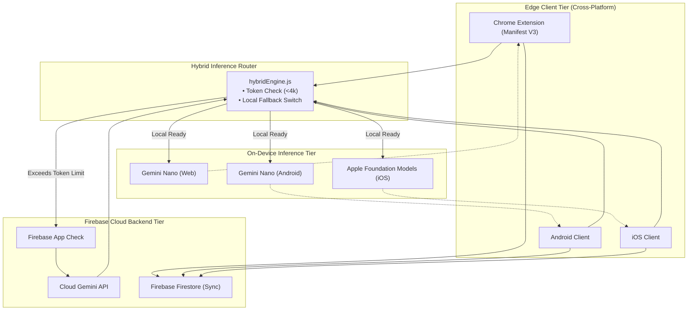

<div align="center">

# GrassVault ⚡☁️
### Edge-First Cross-Platform Personal Intelligence & Security Vault

[](https://firebase.google.com)
[](https://developer.chrome.com)
[]()

</div>

---

## Overview

**GrassVault** is a zero-latency, local-first personal intelligence and security vault designed to capture, organize, and secure snippets, documents, and code blocks seamlessly across **Web, Android, and iOS**. 

By leveraging the **Firebase AI Logic SDK**, GrassVault intelligently routes tasks based on context and device capabilities: executing privacy-sensitive, short-form tasks entirely on-device via **Gemini Nano** (Web/Android) and **Apple Foundation Models** (iOS), while falling back gracefully to cloud inference for heavy multi-document synthesis and cross-device graph routing.

---

## Key Architectural Highlights

- **Multi-Platform Unification:** Single cohesive codebase and state architecture bridging Chrome Extensions (Manifest V3), Android, and iOS clients.
- **Hybrid Inference Router:** Intelligent client-side routing that checks local model availability (`window.ai` / native bindings) before scaling up to cloud endpoints.
- **Zero-Latency Privacy:** Local-first processing ensures sensitive code snippets and clipboard data never leave the device unless explicitly required.
- **Secure Cloud Sync:** Real-time synchronization powered by Firebase Firestore, secured with Firebase App Check.

---

## Systems Architecture 🏦




---

## Tech Stack

- **Client Core:** Vite, Vanilla ES6+, Tailwind CSS (Dark Mode / Glassmorphic UI)
- **Extension Engine:** Chrome Extension Manifest V3 (Service Workers, Content Scripts, MutationObservers)
- **AI & Logic:** Firebase AI Logic SDK, Gemini Nano, Apple Foundation Models
- **Backend & Sync:** Firebase Firestore, Firebase Auth, App Check

---

## Project Structure

```text
grassvault/
├── package.json
├── tailwind.config.js
├── vite.config.js
├── src/
│   ├── manifest.json
│   ├── background/
│   │   └── service-worker.js
│   ├── content/
│   │   └── contentScript.js
│   ├── popup/
│   │   ├── popup.html
│   │   ├── popup.js
│   │   └── popup.css
│   ├── dashboard/
│   │   ├── index.html
│   │   └── app.js
│   └── shared/
│       ├── firebaseConfig.js
│       └── hybridEngine.js
└── README.md

```

---

## Getting Started in GitHub Codespaces
 * Open in Codespaces: Launch this repository directly inside a GitHub Codespace container.
 * Install Dependencies:
   npm install

 * Configure Environment: Create a .env file in the root directory and add your Firebase configuration keys.
 * Build the Extension:
   npm run build

 * Load in Chrome: Navigate to chrome://extensions, enable Developer mode, click Load unpacked, and select the dist/ directory.

---
## License
MIT License — built for the #BuildHybridAI 2026 Hackathon.


